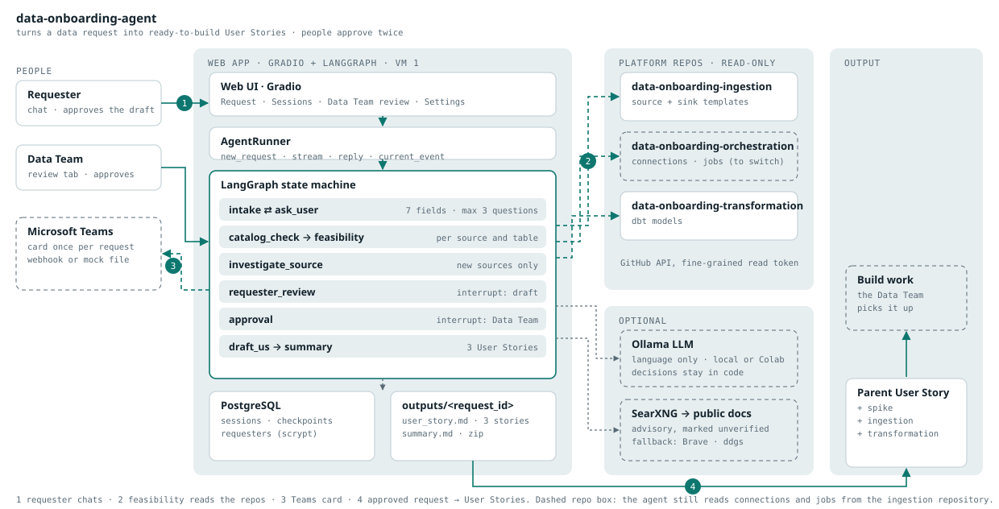

# data-onboarding-agent

**v1.0.0 (Non-Prod)** · [Release notes](#release-v100) · [Demo](#demo-non-prod-video-walkthrough) · [Quick start](#quick-start-non-prod)

An AI agent that turns a data request into ready-to-build work. It asks the requester for what is missing, checks the platform's two repos for what already exists, drafts the User Story, and hands it to the Data Team on Teams. **People approve twice** (the requester the draft, the Data Team the request); nothing is built or sent on the agent's own say-so.

| Without the agent | With the agent |
|---|---|
| A Teams message, rounds of questions, someone reading both repos, a hand-written User Story | ≤ 5 turns of chat, a feasibility check that names the file behind every recommendation, a parent User Story plus 3 linked ones (spike, ingestion, transformation) |

> Everything is in English (UI, questions, User Story, Teams messages, code, docs). The agent still understands answers written in Vietnamese.
> Decisions (routing, validation, feasibility) live in code. The optional LLM only helps with language, and web research is advisory and marked unverified.



---

## Release v1.0.0

**v1.0.0 closes the Non-Prod phase.** The whole flow has been run step by step in GitHub Codespaces (Docker Compose: app + PostgreSQL + SearXNG) against the real ingestion and transformation repos.

| Area | In v1.0.0 |
|---|---|
| Intake | 7 details in a chat, max 3 questions per turn, free text and labelled / numbered answers, relative dates ("in 4 weeks") confirmed, English and Vietnamese |
| Feasibility | Per source: existing dbt model → already landed → new job → new connection (`sqlserver`, `postgresql`, `mysql`, `rest_api`) → gap. Reads both platform repos, no sample data |
| Web research | For sources the platform can't onboard yet: SearXNG + Trafilatura, top 5 links, key passages, questions for the Data Team, all unverified; links learned from approved requests |
| Approval | Requester approves the draft; the Data Team approves or requests changes in its own tab; Teams card once per request |
| Output | `user_story.md` (parent) + 3 User Stories (spike, ingestion, transformation; non-prod and prod parts) + summary, downloaded as one zip |
| Platform | Docker Compose in Codespaces / laptop, PostgreSQL sessions, login with roles (Data Team vs. requesters), CI on every push, offline `pytest` suite |

**Not in v1.0.0 (Prod phase):** running on the production VM (the Deploy workflow and `infrastructure/prod/` are written and wait for VM 1), a production LLM, Teams bot approvals, creating tickets in Azure DevOps / Jira. See [Roadmap](#roadmap-prod-and-after).

---

## Project Demo Non-Prod

Watch the full data-onboarding-agent demo on YouTube: [Watch here](https://youtu.be/6FwHkSyG-8M)

---

## Quick start (Non-Prod)

The same three containers run on a laptop and in GitHub Codespaces (Docker is preinstalled there).

```bash
cp -n infrastructure/non-prod/.env.example infrastructure/non-prod/.env   # then fill it in, see below
docker compose -f infrastructure/non-prod/docker-compose.yml up -d --build
```

Open http://127.0.0.1:7860 (Codespaces: **PORTS** tab → 7860).

| Set | Why |
|---|---|
| `PLATFORM_GITHUB_TOKEN` (a Codespaces secret in a codespace) | Fine-grained, *Contents: Read-only* on the ingestion and transformation repos |
| `ACCOUNTS=data.team@gmail.com:<password>` | The Data Team login. Requesters self-register on first sign-in |
| `TEAMS_WEBHOOK_URL` | Real Teams cards; empty = mock, written to `outputs/<request_id>/teams_messages.jsonl`. Test with `python -m agent.integrations.teams "<url>"` |
| `OLLAMA_*` | Optional model; empty = rule-based (see [Deployment: model on Colab](#deployment-model-on-colab-web-app-on-your-machine)) |

In a codespace where `app` can't reach `postgres` or the internet: `bash infrastructure/non-prod/codespace-network.sh` ([runbook](infrastructure/README.md#codespaces-containers-cant-reach-each-other-or-the-internet)). Settings, data locations and troubleshooting: [infrastructure/README.md](infrastructure/README.md).

---

## Docs

- **[docs/how-it-works.md](docs/how-it-works.md)**: a request from first message to User Story, for requesters and the Data Team
- **[docs/architecture.md](docs/architecture.md)**: components, the agent graph, state, design rules, storage, deployment
- **[docs/phases.md](docs/phases.md)**: status of each phase, known issues, next steps
- **[docs/postgresql.md](docs/postgresql.md)**: the agent's tables, every one checked at a glance, and the queries after a demo
- **[docs/prototype_demo/](docs/prototype_demo/README.md)**: the Non-Prod demo: prepare, happy-path script, results sheet
- **[docs/plan.md](docs/plan.md)**: the original prototype plan

## Status

> Updated: 2026-10-30. v1.0.0 = Non-Prod phase done. Details per item: [docs/phases.md](docs/phases.md).

| Area | Status |
|---|---|
| Intake, knowledge from the two repos, feasibility, approvals, outputs | ✅ Run step by step in the Codespaces demo (Docker, PostgreSQL) |
| Web research (SearXNG + Trafilatura), docs links learned from approved requests | ✅ Real searches ran in a codespace (2026-10-27); ⬜ a second run from the cache with PostgreSQL |
| 3 User Stories per request (spike, ingestion, transformation) + zip | ✅ |
| MySQL and REST API source types; systems known only from dbt models | ✅ Checked offline; ⬜ an API request in a codespace against the real ingestion repo |
| Docker / Codespaces, PostgreSQL sessions, login with roles | ✅ |
| CI on every push (offline `pytest`, ruff, compose, image build) | ✅ |
| Real Teams webhook | ✅ Per the Codespaces demo (check `teams_messages.jsonl` is absent in `outputs/<request_id>/`) |
| Colab-hosted model (Phase 0) | ⬜ Notebook written, not run; the demo ran rule-based |
| Deploy to VM 1 (Prod) | ⬜ Workflow and `infrastructure/prod/` written, waiting for the VM |
| 3–5 real past requests replayed with `agent.workflow.evaluate` | ⬜ |
| Open points of the 3 User Stories (new dataset vs. change, skipping ingestion, int/mart detail) | ⬜ [docs/phases.md](docs/phases.md#3-user-stories-per-request) |

## Roadmap: Prod and after

1. **Prod on VM 1** (the next milestone): set the GitHub secrets and variables ([infrastructure/prod/README.md](infrastructure/prod/README.md)), run the Deploy workflow by hand, repeat the demo there (this repo before data-onboarding-ingestion).
2. A production model: Ollama / vLLM on a GPU VM, or an LLM API approved by the company.
3. Teams bot approvals in the thread; real tickets (`stories.json` for Azure DevOps / Jira); lake metadata for a real date-range check; GitHub MCP.

More in [docs/phases.md](docs/phases.md#after-the-prototype).

---

## Architecture (short)

```
intake ⇄ ask_user ─▶ catalog_check ─▶ feasibility ──gap──▶ intake
                                          │
                       investigate_source (sources new to the platform: no template yet, or a new API)
                                          │
       requester_review (requester checks the draft) ──change──▶ intake
                                          │ approve draft
                     notify (Teams, once) ─▶ approval (Data Team) ──request changes──▶ intake
                                          │ approve
                                 draft_us ─▶ summary ─▶ END
```

Feasibility reads the code of the two platform repos: is the data already a dbt model in [data-onboarding-transformation](https://github.com/thanhphat2609/data-onboarding-transformation), already landing through a job in [data-onboarding-ingestion](https://github.com/thanhphat2609/data-onboarding-ingestion), from an onboarded system (needs a new job), or from a supported source type (needs a new connection)? Decisions (routing, validation, feasibility) live in code; the optional LLM only helps with language. Web research is advisory. Nothing is drafted before the Data Team approves. Full picture: [docs/architecture.md](docs/architecture.md).

## Repo layout

```
data-onboarding-agent/
├── app.py                     # starts the web UI (python app.py [--share] [--host] [--port])
├── notebooks/
│   ├── prototype.ipynb        # Colab: clone, Ollama, tool-calling test, host model via tunnel
│   └── ollama_auth_proxy.py   # API-key proxy in front of Ollama (run by the notebook on Colab)
├── agent/
│   ├── ui/                    # Gradio web UI: views.py (HTML), handlers.py (events + the AgentRunner), style.py, layout.py
│   ├── config.py              # paths + env vars
│   ├── state.py               # TypedDict state + request schema (7 fields + source_origin)
│   ├── auth.py                # login: Data Team accounts, requester self-registration (scrypt hashes)
│   ├── workflow/              # the LangGraph flow
│   │   ├── graph.py           #   build graph, PostgreSQL / SQLite checkpointer
│   │   ├── runner.py          #   start/reply API for the UI and scripts
│   │   ├── sessions.py        #   sessions, requesters, source_docs tables
│   │   ├── extraction.py      #   field extraction (rule-based) + validation, source name cleanup
│   │   ├── followup.py        #   messages while waiting for the Data Team: questions answered, changes confirmed
│   │   ├── evaluate.py        #   run past requests, compare with expectations + team handling
│   │   ├── stories.py         #   the 3 User Stories (spike, ingestion, transformation)
│   │   └── nodes/             #   one file per node:
│   │       ├── intake.py      #     intake + ask_user (incl. "Where does it come from?")
│   │       ├── requester_review.py # requester checks the draft (approve or change)
│   │       ├── notify.py      #     "New data request" Teams card, after the draft is approved
│   │       ├── catalog_check.py #   related dbt models per source
│   │       ├── feasibility.py #     per source: dbt model → landed → new job → new connection → gap
│   │       ├── investigate.py #     web research for sources the platform can't onboard yet
│   │       ├── approval.py    #     pause for the Data Team
│   │       ├── draft_us.py    #     User Story (and the draft preview, template only) + the 3 User Stories (../stories.py)
│   │       ├── summary.py     #     final summary + Teams card
│   │       └── common.py      #     shared helpers (today, output folder)
│   ├── repos/                 # knowledge from the ingestion + transformation repos (local checkout or GitHub)
│   │   ├── __init__.py        #   load / get / reload, parse templates, connections, jobs
│   │   ├── dbt_project.py     #   dbt models from schema .yml files or manifest.json
│   │   ├── github.py          #   GitHub REST: file tree + file content
│   │   └── lookup.py          #   lookup_source, search_models (also the notebook's tool-calling test)
│   ├── research/              # sources the platform can't onboard yet
│   │   ├── investigate.py     #   web research in rounds: top 5 links, key passages, questions, draft notes
│   │   ├── cache.py           #   search results + pages cached 7 days (outputs/cache/research/)
│   │   ├── learned.py         #   docs links learned from approved requests (source_docs table)
│   │   ├── docs_hints.yaml    #   optional seed: official docs of a few sources
│   │   └── websearch/         #   two tools, web_search + web_fetch (port of web-search-mcp, LICENSE kept):
│   │       ├── engines.py     #     web_search: SearXNG → Brave (headless browser) → DuckDuckGo (ddgs)
│   │       ├── content.py     #     web_fetch: HTTP, headless-browser fallback
│   │       ├── extract.py     #     main page text (Trafilatura, rules as fallback)
│   │       ├── browser.py     #     optional headless Chromium (Playwright)
│   │       ├── ratelimit.py   #     max 10 searches a minute (waits)
│   │       ├── models.py      #     SearchResult, SearchResponse, Page
│   │       └── mcp_server.py  #     the two tools as an MCP server
│   ├── llm/                   # optional Ollama client (client.py) + prompts/
│   └── integrations/teams.py  # Teams webhook (or mock); `python -m agent.integrations.teams <url>` sends a test card
├── tests/                     # pytest, offline, run by CI: test_*.py + fixtures/ (small copies of the two platform repos)
├── docs/                      # architecture, how it works, phase status, PostgreSQL queries, prototype_demo/ (demo script)
├── infrastructure/            # Dockerfile, non-prod/ compose (laptop / Codespaces), prod/ (VM 1, draft), postgres/ init, searxng/ settings; see infrastructure/README.md
├── .devcontainer/             # Codespaces: runs infrastructure/non-prod/codespace-network.sh on start
├── .github/workflows/         # ci.yml on every push, deploy.yml run by hand (the approval) once VM 1 exists, delete-merged-branch.yml
├── requirements.txt           # dependencies (Chromium for the headless browser is a separate, optional download)
├── CLAUDE.md                  # rules for working on this repo (docs updated with every change)
└── outputs/                   # results per request_id (gitignored)
```

### Where the knowledge comes from
There is no sample data in this repo. The agent reads the two platform repos on first use (and again on **⚙️ Settings → Reload repositories**):

| Repo | Files read | Tells the agent |
|---|---|---|
| data-onboarding-ingestion | `code/templates/sources/*.yaml` | Source types that can be onboarded (e.g. `sqlserver`, `mysql`, `rest_api`) |
| | `pipelines/connections/*.yaml` | Systems already onboarded (e.g. `crm`) |
| | `pipelines/jobs/*.yaml` | Tables already landing in the lake (`<system>/<schema>/<table>`) |
| data-onboarding-transformation | `models/**/*.yml` (or `target/manifest.json`) | dbt models that already exist |

Set `INGESTION_PATH` / `TRANSFORMATION_PATH` to local checkouts (e.g. `../data-onboarding-ingestion`); otherwise they are read from GitHub with `PLATFORM_GITHUB_TOKEN` or `GITHUB_TOKEN` (fine-grained, *Contents: Read-only* on both repos; use `PLATFORM_GITHUB_TOKEN` in Codespaces).

## Run locally

```powershell
python -m venv .venv
.venv\Scripts\python -m pip install -r requirements.txt

.venv\Scripts\python app.py                   # web UI at http://127.0.0.1:7860 (--share for a public link)
.venv\Scripts\python -m agent.workflow.evaluate <folder>   # replay past requests (YAML) and compare
.venv\Scripts\python -m pip install pytest; .venv\Scripts\python -m pytest -q tests   # the tests CI runs, offline, ~1 s
```

Or activate the venv first (`.venv\Scripts\Activate.ps1`, or `source .venv/bin/activate` on Linux/Mac) and use plain `python`. If PowerShell says running scripts is disabled, run `Set-ExecutionPolicy -Scope CurrentUser RemoteSigned` once.

### Tests

```bash
python -m pip install pytest
python -m pytest -q tests          # ~5 s, offline: no network, LLM or database server
```

CI runs the same tests on every push. They read small copies of the two platform repos in `tests/fixtures/` (the `sqlserver`, `mysql` and `rest_api` templates, the `crm` connection and job, two dbt models) and fake the web search, so they never depend on GitHub or a search engine. Add or update a test with every fix or feature (`CLAUDE.md`).

## Run with Docker / GitHub Codespaces

```bash
docker compose -f infrastructure/non-prod/docker-compose.yml up -d --build
```
Then open http://127.0.0.1:7860. In GitHub Codespaces (Docker is preinstalled), open the forwarded port 7860 from the **PORTS** tab instead.

Three containers start: `app` (web UI and agent), `postgres` (sessions, plus the `airflow` database for data-onboarding-orchestration's Airflow and the `platform` database reserved for data-onboarding-ingestion's run history, see [docs/postgresql.md](docs/postgresql.md#roles-and-passwords)) and `searxng` (web search). Prod on VM 1 runs the same three from `infrastructure/prod/`; CI runs on every push and the Deploy workflow is run by hand ([infrastructure/prod/README.md](infrastructure/prod/README.md)).

For settings (`.env` / Codespaces secrets), where data is stored, port visibility and troubleshooting, see [infrastructure/README.md](infrastructure/README.md).

## Web search and the MCP server

Web research uses two tools from [agent/research/websearch/](agent/research/websearch/), a Python port of [web-search-mcp](https://github.com/mrkrsl/web-search-mcp) (MIT): **`web_search`** (title, URL, snippet per result) and **`web_fetch`** (main text of one page). Search goes to the self-hosted **SearXNG** container first (Docker setups, `SEARXNG_URL`), then to Brave (headless browser) and DuckDuckGo (`ddgs`); no API keys. Pages are read over HTTP with **Trafilatura** for the main text, or in a headless browser when they need JavaScript.

For each source new to the platform (one it can't onboard yet, or a new REST API: the `rest_api` template onboards it, but its auth, pagination and limits still have to be found), research runs in up to 2 rounds (one search per topic, then follow-ups on the docs site for what is still missing) and hands the Data Team the **top 5 links**, key passages, questions and draft source notes. Links from earlier **approved** requests for the same source are learned and always among the links (`source_docs` table), plus a few official docs listed in advance ([docs_hints.yaml](agent/research/docs_hints.yaml)); results that only mention the source in passing are dropped; searches and pages are cached for 7 days, so a second request for the same source gets the same links. All of it is unverified and never changes the feasibility result ([details](docs/architecture.md#web-search)).

- **Headless browser (optional):** `python -m playwright install chromium` once (the Playwright package is in `requirements.txt`). Without it, Brave is skipped (search uses SearXNG, then DuckDuckGo through `ddgs`) and JavaScript-only pages stay unreadable. Docker: `WITH_BROWSER=true`.
- **MCP server** with the same two tools (`web_search`, `web_fetch`), for LM Studio, Claude Desktop or other MCP clients:
  ```json
  {"mcpServers": {"web-search": {"command": "python", "args": ["-m", "agent.research.websearch.mcp_server"],
                                 "cwd": "/path/to/data-onboarding-agent"}}}
  ```

Key-less search (SearXNG included) scrapes public search engines, so they can rate-limit a network for a while. SearXNG makes it rarer by asking several engines at once. When nothing comes back, the agent says "web search found nothing", gives a ready-made search link instead of the top links, and still asks the Data Team its standard questions. When results come back but none names the source, it says so instead: that points to a wrong source name, not a blocked engine.

## Deployment: model on Colab, web app on your machine

```
 Your machine                                    Google Colab (GPU T4)
┌──────────────────────────────┐   HTTPS +    ┌─────────────────────────────────────┐
│ python app.py (web UI)       │   API key    │ cloudflared tunnel                  │
│  ├─ ⚙️ LLM settings ──────────┼─────────────▶│  └─ notebooks/ollama_auth_proxy.py  │
│  ├─ ⚙️ Repositories ─┐        │              │      └─ Ollama (qwen2.5 7B/14B)     │
│  └─ checkpoint, outputs      │              └─────────────────────────────────────┘
└─────────────────────┼────────┘
                      ▼ GitHub token (stays on your machine)
         ingestion + transformation repos (read on demand)
```

Ollama has no authentication, so on Colab `notebooks/ollama_auth_proxy.py` sits in front of it: it requires an API key and only allows read/chat APIs (pull/delete are blocked).

> ⚠️ Free-tier Colab restricts using the runtime as a web service / accessing it outside the notebook UI. Calling the model from your machine through a tunnel may break the terms and get the session cut off — read the Colab FAQ before using it regularly. Fallbacks: run the web app on Colab too (option B in the notebook), or run Ollama on a machine with a GPU / use an LLM API approved by the company.

### Step 1 — Host the model on Colab
1. Create a fine-grained GitHub token with **Contents: Read-only** on this repo only. In Colab, add it under 🔑 **Secrets** as `GITHUB_TOKEN` and turn on *Notebook access* (the repo is private; the token never goes into the notebook).
2. Open [notebooks/prototype.ipynb](notebooks/prototype.ipynb) on Colab (GPU T4 runtime) — *File → Upload notebook*, or *File → Open notebook → GitHub* with *Include private repos*.
3. Run steps 1 → 4. Step 4 prints:
   ```
   Ollama host : https://xxxx.trycloudflare.com
   API key     : ....
   ```
Keep the Colab tab open. The URL changes every time the cell is re-run.

### Step 2 — Open the web app on your machine
```powershell
.venv\Scripts\python app.py   # http://127.0.0.1:7860
```
Open the **⚙️ Settings** tab, **LLM** column:
- **Ollama host**: paste the URL from Colab (for Ollama on your own machine use `http://localhost:11434`)
- **API key**: paste the key from Colab (leave empty for local Ollama)
- **🔄 Fetch models** → pick a model → **Test** → **Apply**
- **Disable LLM**: back to rule-based. The "In use" line shows what the agent is running on.

### Step 3 — Check the repositories
In the **⚙️ Settings** tab, **Repositories** column: where each repo was read from, the systems, jobs and dbt models found, and any error (e.g. a token that can't read a repo). **↻ Reload repositories** reads them again after a merge.

### Defaults at startup
Settings chosen in the UI are lost when the app stops. To have them preset, set env vars before starting:
```powershell
$env:OLLAMA_HOST = "https://xxxx.trycloudflare.com"; $env:OLLAMA_API_KEY = "..."; $env:OLLAMA_MODEL = "qwen2.5:7b"
.venv\Scripts\python app.py
```

### Environment variables

| Variable | Default | Meaning |
|---|---|---|
| `OLLAMA_HOST` | `http://localhost:11434` | Local Ollama URL, or the tunnel URL from Colab |
| `OLLAMA_API_KEY` | (empty) | Key for the proxy on Colab |
| `OLLAMA_MODEL` | (empty) | e.g. `qwen2.5:7b`. Empty = rule-based |
| `GITHUB_TOKEN` | (empty) | Fine-grained token, *Contents: Read-only* on both repos. Not needed with local checkouts |
| `PLATFORM_GITHUB_TOKEN` | (empty) | Same token under a name that wins over `GITHUB_TOKEN`. Use it in Codespaces, where `GITHUB_TOKEN` is preset for the codespace's own repo and a secret can't be named `GITHUB_*` |
| `INGESTION_REPO`, `INGESTION_REF` | `thanhphat2609/data-onboarding-ingestion`, `main` | |
| `TRANSFORMATION_REPO`, `TRANSFORMATION_REF` | `thanhphat2609/data-onboarding-transformation`, `main` | |
| `INGESTION_PATH`, `TRANSFORMATION_PATH` | (empty) | Local checkouts; win over GitHub |
| `TRANSFORMATION_DBT_DIR` | (empty) | dbt project folder inside the transformation repo |
| `DATABASE_URL` | (empty) | PostgreSQL for sessions, e.g. `postgresql://agent:…@postgres:5432/onboarding_agent` (set by Docker compose). Empty = SQLite at `CHECKPOINT_DB` |
| `CHECKPOINT_DB` | `./checkpoints.db` | SQLite file when `DATABASE_URL` is empty |
| `OUTPUT_DIR` | `./outputs` | |
| `TEAMS_WEBHOOK_URL` | (empty) | Empty = mock, writes to a file |
| `ACCOUNTS` | (empty) | Web UI logins, `user:password` pairs separated by commas; usually only the Data Team (other emails self-register on first sign-in). Empty = no login, every tab open |
| `ACCOUNTS_FILE` | (empty) | Same, one `user:password` per line (e.g. a Docker secret); `#` starts a comment |
| `DATA_TEAM` | `data.team@gmail.com` | Accounts with full access (review, Settings, Debug, every session). Others are requesters: Request + their own Sessions |
| `WEB_RESEARCH` | `1` | `0` = no web research for sources the platform can't onboard yet (questions are still generated) |
| `RESEARCH_MAX_PAGES` | `8` | Pages read per source, across all rounds |
| `RESEARCH_ROUNDS` | `2` | Research rounds per source: planned searches, then follow-up searches on the docs site for topics still without evidence |
| `RESEARCH_TIME_BUDGET_S` | `180` | Seconds of research per source before it stops with what it has |
| `RESEARCH_CACHE_DAYS` | `7` | Days search results and pages stay cached in `outputs/cache/research/`, so the same source gets the same links again; `0` = off |
| `WEBSEARCH_BROWSER` | `auto` | `off` = never use the headless browser, even when Playwright is installed |
| `SEARXNG_URL` | empty (compose: `http://searxng:8080`) | Self-hosted SearXNG, the first search engine for web research; empty = only Brave (with the browser) and DuckDuckGo (`ddgs`) |
| `RELEVANCE_THRESHOLD`, `ENABLE_RELEVANCE_CHECKING`, `FORCE_MULTI_ENGINE_SEARCH` | `0.3`, `true`, `false` | Search result quality check (same as web-search-mcp) |
| `MAX_CONTENT_LENGTH`, `DEFAULT_TIMEOUT` | `500000`, `6000` (ms) | Page content limit and fetch timeout |
