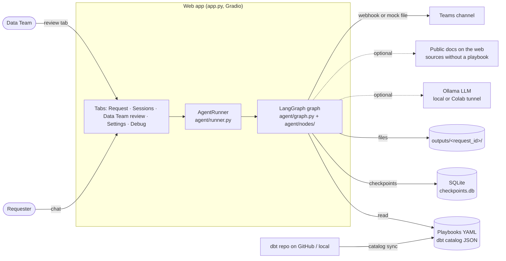
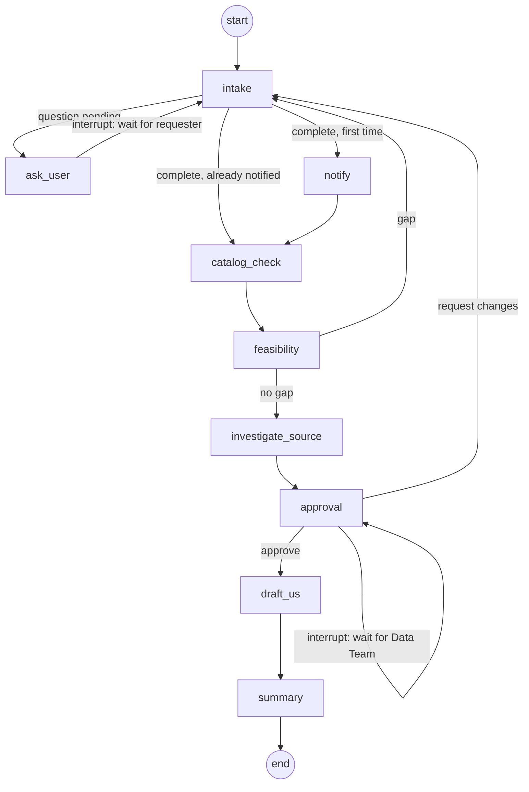

# Architecture

The Data Onboarding Agent is a **LangGraph state machine** with a **Gradio web UI** in front of it. Requesters describe the data they need in a chat. The agent fills a structured request, checks it against the team's knowledge (source playbooks and the dbt catalog), and hands it to the **Data Team** for approval. After approval it writes a User Story and posts a summary to Teams.

## System context

## Components

| Component | Files | Role |
|---|---|---|
| Web UI | [app.py](../app.py) | Gradio app. Shows the chat, step tracker, request card and results. Holds the Data Team review queue. Also has settings for the LLM and the dbt catalog sync |
| Runner | [agent/runner.py](../agent/runner.py) | Thin API over the graph: `new_request`, `stream`, `reply`, `current_event`, `state`, `threads`. Used by the UI and the scripts |
| Graph | [agent/graph.py](../agent/graph.py) | Wires the nodes and routing functions; compiles with the SQLite checkpointer |
| Nodes | [agent/nodes/](../agent/nodes/) | One file per step (see [The graph](#the-graph)) |
| State | [agent/state.py](../agent/state.py) | `AgentState` TypedDict, the 7 required request fields, the questions for each field |
| Extraction | [agent/extraction.py](../agent/extraction.py) | Rule-based field extraction (English + Vietnamese keywords) and validation; LLM extraction when a model is configured |
| Knowledge | [agent/knowledge.py](../agent/knowledge.py) | `lookup_playbook(source)`, `search_catalog(query)` (token-overlap score) |
| Catalog sync | [agent/catalog_sync.py](../agent/catalog_sync.py), [scripts/export_dbt_catalog.py](../scripts/export_dbt_catalog.py) | Build `catalog/dbt_models.json` from a GitHub dbt repo, a local dbt project or a `manifest.json` |
| Web research | [agent/research.py](../agent/research.py) | For sources without a playbook: find and read public docs, draft a playbook, list questions for the Data Team |
| LLM client | [agent/llm.py](../agent/llm.py), [agent/prompts/](../agent/prompts/) | Optional Ollama client (API key support for the Colab proxy); prompts as Markdown files |
| Teams | [agent/integrations/teams.py](../agent/integrations/teams.py) | Adaptive Card to a Workflows webhook; without a URL (or on failure) writes `teams_messages.jsonl` |
| Config | [agent/config.py](../agent/config.py) | Paths and env vars; falls back to `demo/` knowledge while no real data exists |
| Infrastructure | [infrastructure/](../infrastructure/) | Dockerfile + compose for laptop, VM and Codespaces |

## The graph

| Node | File | What it does | Writes to state |
|---|---|---|---|
| `intake` | [intake.py](../agent/nodes/intake.py) | Extracts fields from new user messages, validates them (dates, ETA after today, refresh frequency) and decides what to ask next: missing fields (max 3 per turn) or a gap to resolve | `request`, `missing_fields`, `errors`, `gap`, `accepted_gaps`, `pending_question` |
| `ask_user` | [intake.py](../agent/nodes/intake.py) | `interrupt()`: pauses the graph until the requester answers | `messages` |
| `notify` | [notify.py](../agent/nodes/notify.py) | Once per request: writes `request.json`, posts "New data request" to Teams | `thread_ref` |
| `catalog_check` | [catalog_check.py](../agent/nodes/catalog_check.py) | Searches the dbt catalog per source for models that already hold the data | `existing_models` |
| `feasibility` | [feasibility.py](../agent/nodes/feasibility.py) | Per source: playbook lookup, compares the requested start date with each option's `available_from`, prefers existing models, flags tight ETAs and unreviewed playbooks | `feasibility`, `gap` |
| `investigate_source` | [investigate.py](../agent/nodes/investigate.py) | Only for sources without a playbook: web research and a draft playbook (advisory) | `research` |
| `approval` | [approval.py](../agent/nodes/approval.py) | `interrupt()`: pauses until the Data Team approves or requests changes | `approved`, `review_comment` |
| `draft_us` | [draft_us.py](../agent/nodes/draft_us.py) | User Story from a fixed template (LLM only writes title/description); writes `feasibility.json`, `user_story.md` | `outputs` |
| `summary` | [summary.py](../agent/nodes/summary.py) | Writes `summary.md`, posts "Request approved — User Story ready" to Teams | `outputs` |

### Interrupts are the hand-off points

The graph stops in exactly two places, both with LangGraph's `interrupt()`:

- **`ask_user`**: waiting for the **requester**. The UI resumes it with `Command(resume=<answer text>)`.
- **`approval`**: waiting for the **Data Team**. The review tab resumes it with `Command(resume={"action": "approve" | "edit", "comment": ...})`.

`AgentRunner.current_event(thread_id)` turns the paused state into an event the UI renders: `question`, `approval`, `done` or `empty` (still running / not started).

## State

`AgentState` ([agent/state.py](../agent/state.py)), the most important keys:

| Key | Meaning |
|---|---|
| `request_id` | `REQ-<yyyymmdd>-<6 chars of thread_id>`; folder name in `outputs/` |
| `messages` | Chat history (append-only) |
| `request` | The 7 required fields: `dataset_description`, `sources`, `date_range`, `eta`, `refresh_frequency`, `grain`, `consumers` |
| `missing_fields`, `errors` | What is still missing or invalid |
| `gap`, `accepted_gaps` | Open feasibility gaps (`date_range`, `unknown_source`) and the ones the requester accepted |
| `existing_models`, `feasibility` | Catalog matches and the per-source assessment with recommendation and risks |
| `research` | Web research findings per source without a playbook |
| `approved`, `review_comment` | The Data Team's decision |
| `outputs` | Paths of the generated files and the User Story title |

One chat session = one LangGraph `thread_id`. Every step is checkpointed in SQLite, so a session survives restarts and can be reopened from the **Sessions** tab.

## Design rules

1. **Decisions live in code; the LLM only helps with language.** Routing, validation and feasibility are deterministic Python. The LLM (if configured) extracts free-text fields, rephrases questions and writes the User Story title and description. If it is missing or fails, the rule-based path takes over (`safe_call`).
2. **Never guess source facts.** Date availability, lookback limits and lead times come only from playbooks and the catalog. Every recommendation cites its file.
3. **Web research is advisory.** Findings for unknown sources go into the User Story and the questions for the Data Team. They never change the feasibility result: the source stays *Needs investigation* until a reviewed playbook exists.
4. **A human approves.** Nothing is drafted until the Data Team approves. A requested change sends the request back through intake and feasibility.
5. **Demo data is labelled.** While `playbooks/` or `catalog/` is empty the agent falls back to `demo/` and says so in the header pill and as a risk on every request.
6. **External calls must not break the flow.** A failing Teams webhook or web page is logged to a file and the flow continues.

## Knowledge

| Source | Location | Used by |
|---|---|---|
| Playbooks, one YAML per source | `playbooks/` (fallback `demo/playbooks/`) | `feasibility`: access methods, `available_from`, `max_lookback_days`, `typical_lead_time_days`, `review_status` |
| dbt catalog | `catalog/dbt_models.json` (fallback `demo/catalog/`) | `catalog_check`, `feasibility`: existing models and their `data_from` |
| Doc links | `doc_links.yaml` | `investigate_source`: official docs to read first |

The catalog is built by the **Settings → dbt catalog** panel or `scripts/export_dbt_catalog.py` from `target/manifest.json` if present, else from the schema `.yml` files.

## Storage

| What | Where | Notes |
|---|---|---|
| Sessions (checkpoints) | `CHECKPOINT_DB`, default `./checkpoints.db`; `outputs/checkpoints.db` in Docker | SQLite. PLAN: Postgres after the prototype |
| Per-request files | `outputs/<request_id>/` | `request.json`, `feasibility.json`, `user_story.md`, `summary.md`, `teams_messages.jsonl`, `playbook_draft_<source>.yaml` |
| Evaluation runs | `outputs/eval/<timestamp>/` | `report.md`, `mistakes.csv` from `scripts/run_samples.py` |

## Web UI

The UI keeps no state of its own beyond the current `thread_id`: every panel is re-rendered from the graph state (`_view` in [app.py](../app.py)).

| Tab | For | What it does |
|---|---|---|
| 💬 Request | Requester | Chat with example prompts. A step tracker (Describe → Details → Feasibility → Review → User Story), a live "Your request" card, a read-only "Waiting for Data Team review" panel, and the finished User Story with downloads |
| 🗂 Sessions | Anyone | Reopen a recent session (from the checkpointer) or one pasted by `thread_id` |
| 🛡 Data Team review | Data Team | Queue of requests waiting for approval; request card + feasibility; **Approve** / **Request changes**. Behind `REVIEWER_KEY` if set |
| ⚙️ Settings | Admin | LLM host/model/API key at runtime; dbt catalog sync |
| 🔧 Debug | Developer | Raw state JSON |

While a request waits for review, the Request tab polls every 5 seconds (`gr.Timer`). It compares a fingerprint of the thread (message count + event type) and re-renders when the Data Team's decision lands.

> `REVIEWER_KEY` is a soft gate, not authentication: the app has no logins. Keep the port private (see [infrastructure/README.md](../infrastructure/README.md)).

## Deployment

| Where | How | Model |
|---|---|---|
| Laptop (venv) | `python app.py` | Rule-based, local Ollama, or Colab via tunnel |
| Docker (laptop / VM) | `docker compose -f infrastructure/compose.yaml up -d --build` | Same; host Ollama via `host.docker.internal` |
| GitHub Codespaces | Same compose command (Docker is preinstalled) | Colab via tunnel |
| Colab only | Notebook option B: app with `share=True` on Colab | Ollama on the Colab GPU |

The Colab-hosted model sits behind [scripts/ollama_auth_proxy.py](../scripts/ollama_auth_proxy.py) (API key, read/chat endpoints only) and a cloudflared tunnel. See the main [README](../README.md#deployment-model-on-colab-web-app-on-your-machine).

## Extension points

| To… | Change |
|---|---|
| Support a new source | Add `playbooks/<source>.yaml` (or promote a `playbook_draft_<source>.yaml` after review) |
| Add a required field | `REQUIRED_FIELDS` / `FIELD_QUESTIONS` in `state.py`, extraction + validation in `extraction.py`, `FIELD_NAMES` in `app.py`, the User Story template |
| Add a step | New node in `agent/nodes/`, wire it in `graph.py`, add it to `NODE_STATUS` / `NODE_STEP` in `app.py` |
| Swap the checkpointer | `get_checkpointer` in `graph.py` (e.g. Postgres); `AgentRunner.threads` reads the SQLite table directly |
| Create real tickets | After `draft_us`: a node that calls Azure DevOps / Jira (out of scope for the prototype) |
