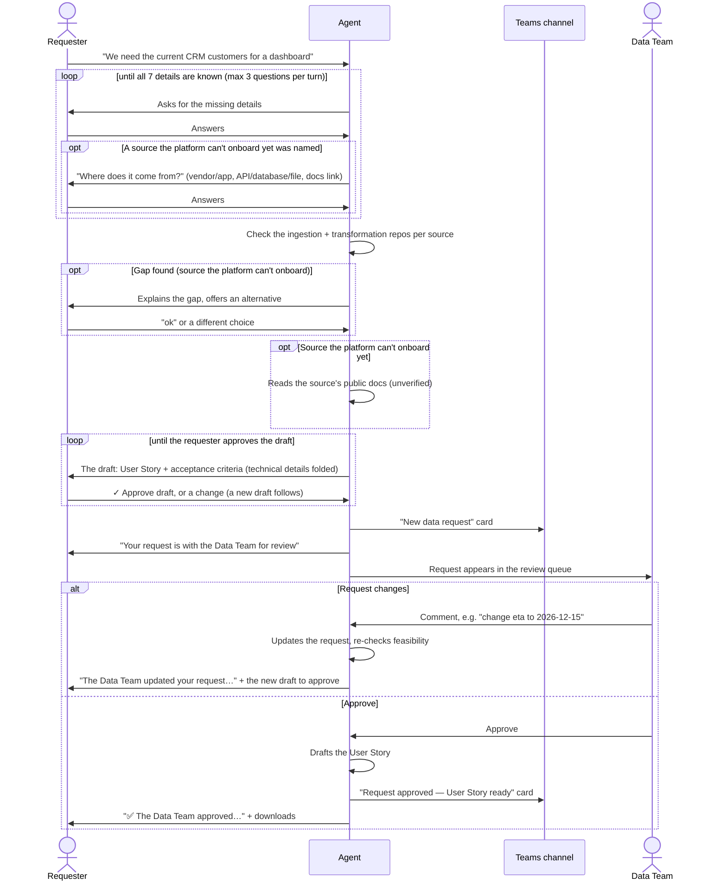

# How it works

This walks one data request from the first message to the finished User Story. There are two roles:

- **Requester**: anyone who needs data, such as a marketing analyst. Uses the **💬 Request** tab.
- **Data Team**: reviews and approves requests. Uses the **🛡 Data Team review** tab, and gets Teams messages.

## The whole journey



## Step by step

The step tracker at the top of the Request tab follows these stages.

### 1. Describe

The requester writes what they need in their own words, in English or Vietnamese, or clicks an example. A new session starts with its own `thread_id` and a `request_id` such as `REQ-20261023-d92104`.

### 2. Details: the `intake` loop

The agent needs **7 details**:

| Detail | Example |
|---|---|
| What (dataset description) | Current CRM customers with their segment for a sales dashboard |
| Sources | `crm` ("Which dataset or product is it?"; the question lists the systems onboarded in the ingestion repo; a new one is named exactly, e.g. "Google Search Console", "ERP on PostgreSQL". Lead-ins such as "product called:" are dropped) |
| Date range | 2024-01-01 → now |
| Go-live (ETA) | 2026-11-30 or "in 3 weeks", must be after today |
| Refresh | daily / hourly / weekly / one-off |
| Grain | one row per customer |
| Used by | Sales team, Power BI dashboard |

**Where does it come from?** When a source is one the platform can't onboard yet, the next question, asked on its own, is where it comes from: the vendor/app and how the data is reached (API, database, file export…), with a docs link if the requester has one. The answer goes into the User Story for the Data Team; a pasted link is read first by the web research, and a known vendor name ("Google") is added to the search name.

After each message the agent extracts what it can (rules first; an LLM if configured), validates it, and asks for **at most 3 missing details per turn**. The answers can be numbered (`1. …`, one per line) or labelled (`eta: 2026-11-30`). The go-live date can also be relative: "in 2 weeks", "end of next month", "2 tuần nữa"; for a range such as "in 2 or 3 weeks" the agent takes the earlier date. The agent confirms the date it computed. Invalid values, such as an ETA in the past, are asked again with a ⚠️ note. If nothing in an answer matches the questions, the agent says so and asks again. The **Your request** card on the right fills in as details arrive.

When all 7 are known, the agent checks feasibility (step 3), then shows the requester a draft (step 4). The **"New data request"** Teams card is only posted once the requester approves that draft.

### 3. Feasibility: `catalog_check` + `feasibility`

For each source, the agent looks in the two platform repos, from least to most work:

| # | Check | Found in | Recommendation | Example (repos today) |
|---|---|---|---|---|
| 1 | A dbt model already has this data | data-onboarding-transformation `models/` | **Existing dbt model**: reuse it | "current CRM customers" → `crm_customers_current` |
| 2 | The table already lands in the lake | data-onboarding-ingestion `pipelines/jobs/` | **Landed, needs dbt model** | a CRM table with a job but no model yet |
| 3 | The system is onboarded, but not this table | `pipelines/connections/` | **New ingestion job** on that connection, then dbt models | "CRM segments" → job on `crm-sqlserver-nonprod` |
| 4 | The source type is supported | `code/templates/sources/` | **New connection** from that template, a job, dbt models | "HR on SQL Server" → `sqlserver` template |
| 5 | None of the above | | **Gap**: the platform can't onboard it yet | "ERP on PostgreSQL" (no PostgreSQL template yet) |

The check works per table: the agent matches the tables the request names ("customers") against job tables and model names. If the request names no table the platform knows, it doesn't assume one exists and adds a risk asking the Data Team to confirm the tables.

**Risks** are added for:
- a tight ETA (rough team estimates per kind of work in `LEAD_TIME_DAYS`);
- history: ingestion keeps one snapshot per day from its first run, so older data is only available as it is in the source today;
- a repo that couldn't be read.

The result is **Feasible**, **Feasible with risks**, or **Gap found**.

**When there's a gap**, the request goes back to the requester (the step tracker shows an amber **!**). They can reply `ok` to continue (the source stays *Needs investigation*), optionally pasting a link to the source's API docs, or name another source.

### 3b. Sources the platform can't onboard yet: `investigate_source`

If the requester accepted such a source, the agent looks up public documentation, in rounds like a person would:

1. **Round 1:** links the requester pasted are read first, then the source's known official docs (e.g. the Search Console API pages), which are always listed. Then one search per topic (access/export, history/retention, rate limits, auth) plus the official docs, with the plain source name (no quotes). Search goes to the self-hosted SearXNG container first, then to Brave and DuckDuckGo; no API keys. Results whose title or URL doesn't name the source (a Google Analytics page that only mentions Search Console), and forum/video sites, are dropped; so is a page whose text never names it. Results are cached for 7 days, so asking about the same source again gives the same links, faster.
2. Reads the best pages (the source's own docs site first) over HTTP, or in the headless browser when a page needs JavaScript, and keeps the most useful sentences about history/retention, quotas, auth and access methods, those with a number first.
3. **Round 2:** topics still without evidence get follow-up searches on the docs site. Up to 8 pages and 180 seconds per source.
4. Writes the **top 5 links** (read or not, each with the topics it was found for), **draft source notes** `outputs/<request_id>/source_notes_<source>.yaml` and a list of **questions for the Data Team**. The links are in the User Story, the review panel and the Teams summary; if every search came back empty, a ready-made search link takes their place.

All of this is marked **unverified** and never changes the feasibility result. Only the source name and fixed keywords are sent to the search engine, never the request text. Turn it off with `WEB_RESEARCH=0`.

### 4. Draft: the requester checks it (`requester_review`)

The requester sees the **draft** on the right: the User Story sentence, the acceptance criteria and the description first, and the technical part (sources and feasibility, proposed pipeline, web research, risks) folded under *Technical details*. It is built from the same template as the final User Story, without the LLM, so it appears at once; the step tracker shows **Draft**.

- **✓ Approve draft** (or typing `ok`): the request goes to the Data Team, and the **"New data request"** card is posted to Teams (once per request; writes `request.json`).
- **A change**, e.g. `eta: 2026-12-01` or `grain: date x page`: applied at once (nothing was sent yet), feasibility is re-checked and a new draft is shown.
- **A question**, e.g. *"what does the platform have for crm?"*: answered from the two repos; the draft stays as it is.

Nothing reaches the Data Team until the requester approves.

### 5. Review: the Data Team decides (`approval`)

The requester now sees **"Waiting for Data Team review"** with the feasibility result (read-only). Their page checks every 5 seconds for a decision. They can close it and come back later from **Sessions**.

In the **🛡 Data Team review** tab, the queue lists every request waiting for approval. Opening one shows:

- the request card (all 7 details);
- the feasibility check: overall status, the recommendation per source (with the file it came from), web research notes and risks.

The reviewer then either:

- **Approves.** The agent writes the final User Story (step 6).
- **Requests changes** with a comment, for example `change eta to 2026-12-15` or `source: crm`. The comment is applied to the request like a requester's edit: fields are re-extracted, feasibility is re-checked, and the requester gets the **new draft** to approve (step 4) before it comes back to the review queue. If something becomes missing or a new gap appears, the requester is asked first. The requester sees *"The Data Team updated your request: …"*.

The requester can also change their own request while it waits, by typing in the chat (they confirm the change first). That re-runs the same path, including a new draft to approve.

Only Data Team accounts (`DATA_TEAM`) see the review tab. Requesters sign in with their own account and only see their own requests in **Sessions**.

### 6. User Story: `draft_us` + `summary`

The agent fills a fixed template: title, user story, description, sources and feasibility, proposed pipeline per source, acceptance criteria, risks, information sources, and (for unknown sources) web research plus questions for the Data Team. With an LLM, the title and description read better. Everything else is deterministic and cites the file in the ingestion or transformation repo it came from.

Then the work itself, as **3 User Stories done in order** (each blocked by the one before), one file each to copy into the backlog and all three appended to `user_story.md`:

| # | User Story | Repo | Content |
|---|---|---|---|
| 1/3 | **Spike** | none | What is known (recommendation, origin, top links, draft source notes) and what to find out: source and access, freshness and **update latency**, history back to the start date, grain and fields, strengths, weaknesses. Done when there is a go/no-go, an access route and the update latency |
| 2/3 | **Ingestion** | data-onboarding-ingestion | Per source, from the feasibility result: a source template, a connection, a job, or nothing new (data already lands; re-ingest only if columns are missing). Lands 1:1, append-only. **Non-prod** (codespace, run by hand) then **prod** (pull request to `pipelines/`, a new secret in GitHub + Deploy, backfill) |
| 3/3 | **Transformation** | data-onboarding-transformation | **Staging** reloading the last N days (N = update latency from 1/3, since ingestion only appends), **int** at the requested grain, **mart** with `_dbt_loaded_at` / `_dbt_run_date`; or reuse the existing dbt model. Tests and a freshness test. **Non-prod** (`dbt build`, reconcile) then **prod** |

The spike is always there, also when the data exists: a change such as new columns needs one too.

Then it writes `summary.md` and posts **"Request approved — User Story ready"** to Teams, with the 3 User Stories listed in order. The requester gets **⬇ User Story** (all of it, including the 3 stories) / **⬇ Summary** downloads and a preview.

## What gets written

```
outputs/REQ-20261023-d92104/
├── request.json              # when the requester approves the draft (step 4)
├── teams_messages.jsonl      # only if Teams is mocked or the webhook failed
├── source_notes_<src>.yaml   # only for sources the platform can't onboard yet (step 3b)
├── feasibility.json          # after the Data Team approves (step 6)
├── user_story.md             # step 6: the request's User Story + the 3 User Stories
├── us_1_spike.md             # step 6
├── us_2_ingestion.md         # step 6
├── us_3_transformation.md    # step 6
└── summary.md                # step 6
```

## With or without an LLM

| | Rule-based (no model) | With an LLM (Ollama) |
|---|---|---|
| Field extraction | Keywords, dates, numbered/labelled answers | Plus free-text understanding; rules still win for dates, sources, refresh |
| Questions | Fixed wording | Rephrased to sound natural |
| User Story | Template, title from the description | Template, LLM-written title and description |
| Web research | Top 5 links, key passages + standard questions | Plus a summary and access methods in the draft source notes |
| Routing, validation, feasibility | Code | Code (unchanged) |

The header pill shows which mode is active. Switch it in **⚙️ Settings → LLM**.

## Try it

1. Start the app: `python app.py`, or `docker compose -f infrastructure/non-prod/docker-compose.yml up -d --build`.
2. In **💬 Request**, click the "Current CRM customers" example and answer the questions. Check the draft on the right: type `eta: 2026-12-01` to see a new draft, then click **✓ Approve draft**.
3. Open **🛡 Data Team review**, pick the request, and click **Request changes** with `change eta to 2026-12-15`. Then go back to **💬 Request** and watch it update.
4. Approve it in the review tab, then download the User Story in **💬 Request**.
5. Try the "CRM segments" and "HR on SQL Server" examples to see a new ingestion job and a new connection.

To replay past requests as scripted conversations: `python -m agent.workflow.evaluate <folder>` (see [PHASES.md](PHASES.md#phase-5--teams--demo); template in [prototype_demo/past_requests/](prototype_demo/past_requests/_template.yaml)).

The full team demo, with what each window should show at every step: [prototype_demo/02_happy_path.md](prototype_demo/02_happy_path.md).
