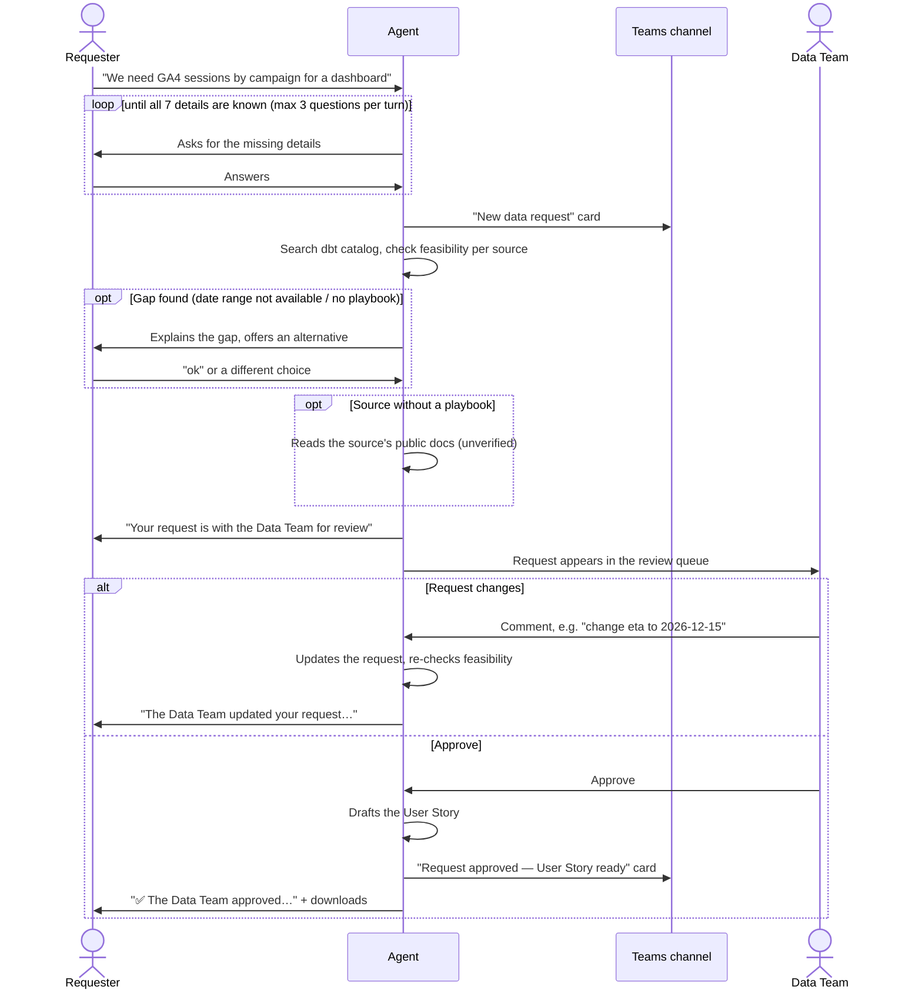

# How it works

This walks one data request from the first message to the finished User Story. There are two roles:

- **Requester**: anyone who needs data, such as a marketing analyst. Uses the **💬 Request** tab.
- **Data Team**: reviews and approves requests. Uses the **🛡 Data Team review** tab, and gets Teams messages.

## The whole journey



## Step by step

The step tracker at the top of the Request tab follows these stages.

### 1. Describe

The requester writes what they need in their own words, in English or Vietnamese, or clicks an example. A new session starts with its own `thread_id` and a `request_id` such as `REQ-20261023-d92104`.

### 2. Details: the `intake` loop

The agent needs **7 details**:

| Detail | Example |
|---|---|
| What (dataset description) | GA4 sessions, users, conversions for a channel dashboard |
| Sources | GA4 (known: GA4, GSC, AppsFlyer, CM, GAM, DV360, DataForSEO; others are allowed) |
| Date range | 2024-01-01 → now |
| Go-live (ETA) | 2026-11-30, must be after today |
| Refresh | daily / hourly / weekly / one-off |
| Grain | date × source × medium × campaign |
| Used by | Marketing team, Looker Studio dashboard |

After each message the agent extracts what it can (rules first; an LLM if configured), validates it, and asks for **at most 3 missing details per turn**. The answers can be numbered (`1. …`, one per line) or labelled (`eta: 2026-11-30`). The go-live date can also be relative: "in 2 weeks", "end of next month", "2 tuần nữa". The agent confirms the date it computed. Invalid values, such as an ETA in the past, are asked again with a ⚠️ note. If nothing in an answer matches the questions, the agent says so and asks again. The **Your request** card on the right fills in as details arrive.

When all 7 are known, the agent posts a **"New data request"** card to Teams. This happens once per request, and writes `request.json`.

### 3. Feasibility: `catalog_check` + `feasibility`

For each source:

1. **Existing data?** The dbt catalog is searched for models of that source that match the description and grain. If one covers the requested start date, it is the recommendation: *reuse, no new ingestion*.
2. **Otherwise, the playbook.** Each access method in `playbooks/<source>.yaml` has an `available_from` (or a `max_lookback_days`). The first option that covers the requested start date wins.
3. **Risks** are added for a tight ETA (`today + typical_lead_time_days > ETA`), a playbook that isn't `reviewed`, and DEMO data.

The result is **Feasible**, **Feasible with risks**, or **Gap found**.

**When there's a gap**, the request goes back to the requester (the step tracker shows an amber **!**):

| Gap | Example | Requester can… |
|---|---|---|
| `date_range` | Wants GA4 from 2020, but the BigQuery export starts 2023-06-01 | Reply `ok` to start from the earliest available date, or propose another range or source |
| `unknown_source` | TikTok Ads has no playbook | Reply `ok` to continue (the source stays *Needs investigation*), optionally pasting a link to its API docs; or pick another source |

### 3b. Sources without a playbook: `investigate_source`

If the requester accepted a source without a playbook, the agent looks up public documentation:

1. Links the requester pasted → links in `doc_links.yaml` → a web search (DuckDuckGo) for the rest, max 3 pages.
2. Reads them and keeps sentences about history/retention, quotas, auth and access methods.
3. Writes a **draft playbook** `outputs/<request_id>/playbook_draft_<source>.yaml` and a list of **questions for the Data Team**.

All of this is marked **unverified** and never changes the feasibility result. Only the source name and fixed keywords are sent to the search engine, never the request text. Turn it off with `WEB_RESEARCH=0`.

### 4. Review: the Data Team decides (`approval`)

The requester now sees **"Waiting for Data Team review"** with the feasibility result (read-only). Their page checks every 5 seconds for a decision. They can close it and come back later from **Sessions**.

In the **🛡 Data Team review** tab, the queue lists every request waiting for approval. Opening one shows:

- the request card (all 7 details);
- the feasibility check: overall status, the recommendation per source (with the file it came from), web research notes and risks.

The reviewer then either:

- **Approves.** The agent drafts the User Story (step 5).
- **Requests changes** with a comment, for example `change eta to 2026-12-15` or `source: ga4`. The comment is applied to the request like a requester's edit: fields are re-extracted, feasibility is re-checked, and the request comes back to the review queue. If something becomes missing or a new gap appears, the requester is asked first. The requester sees *"The Data Team updated your request: …"*.

The requester can also change their own request while it waits, by typing in the chat. That re-runs the same path.

If `REVIEWER_KEY` is set, the review tab asks for it first.

### 5. User Story: `draft_us` + `summary`

The agent fills a fixed template: title, user story, description, sources and feasibility, proposed pipeline per source, acceptance criteria, risks, information sources, and (for unknown sources) web research plus questions for the Data Team. With an LLM, the title and description read better. Everything else is deterministic and cites the playbook or catalog.

Then it writes `summary.md` and posts **"Request approved — User Story ready"** to Teams. The requester gets **⬇ User Story** / **⬇ Summary** downloads and a preview.

## What gets written

```
outputs/REQ-20261023-d92104/
├── request.json              # after intake (step 2)
├── teams_messages.jsonl      # only if Teams is mocked or the webhook failed
├── playbook_draft_<src>.yaml # only for sources without a playbook (step 3b)
├── feasibility.json          # after approval (step 5)
├── user_story.md             # step 5
└── summary.md                # step 5
```

## With or without an LLM

| | Rule-based (no model) | With an LLM (Ollama) |
|---|---|---|
| Field extraction | Keywords, dates, numbered/labelled answers | Plus free-text understanding; rules still win for dates, sources, refresh |
| Questions | Fixed wording | Rephrased to sound natural |
| User Story | Template, title from the description | Template, LLM-written title and description |
| Web research | Key passages + standard questions | Plus a summary and access methods in the draft playbook |
| Routing, validation, feasibility | Code | Code (unchanged) |

The header pill shows which mode is active. Switch it in **⚙️ Settings → LLM**.

## Try it

1. Start the app: `python app.py`, or `docker compose -f infrastructure/compose.yaml up -d --build`.
2. In **💬 Request**, click the GA4 example and answer the questions.
3. Open **🛡 Data Team review**, pick the request, and click **Request changes** with `change eta to 2026-12-15`. Then go back to **💬 Request** and watch it update.
4. Approve it in the review tab, then download the User Story in **💬 Request**.
5. Try the TikTok example to see a source without a playbook.

Scripted runs of the same scenarios: `python scripts/run_samples.py` (see [PHASES.md](PHASES.md#phase-5--teams--demo)).
