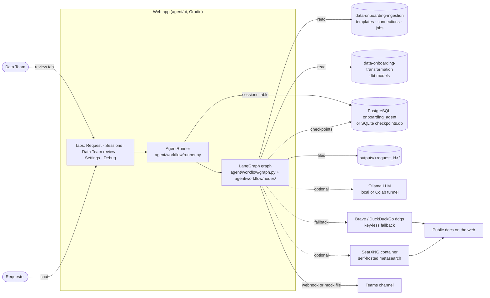
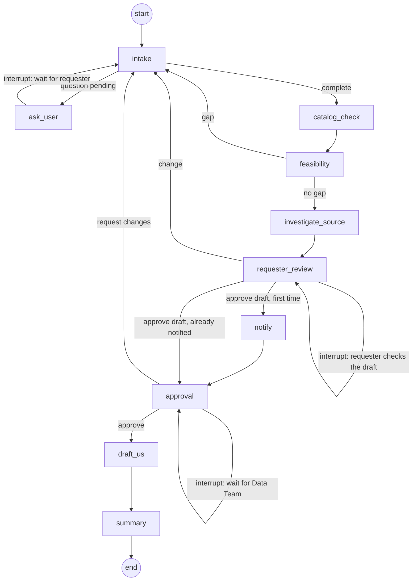

# Architecture

The Data Onboarding Agent is a **LangGraph state machine** with a **Gradio web UI** in front of it. Requesters describe the data they need in a chat. The agent fills a structured request, checks it against the code of the two platform repositories, [data-onboarding-ingestion](https://github.com/thanhphat2609/data-onboarding-ingestion) and [data-onboarding-transformation](https://github.com/thanhphat2609/data-onboarding-transformation), to see what already exists and what has to be built, and hands it to the **Data Team** for approval. After approval it writes a User Story and posts a summary to Teams.

## System context

## Components

| Component | Files | Role |
|---|---|---|
| Web UI | [agent/ui/](../agent/ui/), started by [app.py](../app.py) | Gradio app. Shows the chat, step tracker, request card and results. Holds the Data Team review queue. Also has settings for the LLM and the repositories the agent reads |
| Runner | [agent/workflow/runner.py](../agent/workflow/runner.py) | Thin API over the graph: `new_request`, `stream`, `reply`, `current_event`, `state`, `threads`. Keeps the sessions table current after every run. Used by the UI and the scripts |
| Sessions | [agent/workflow/sessions.py](../agent/workflow/sessions.py) | `SessionStore`: one row per thread_id (owner, who typed it, status, reviewer) in the checkpointer's database, so lists and ownership checks are plain SQL |
| Graph | [agent/workflow/graph.py](../agent/workflow/graph.py) | Wires the nodes and routing functions; compiles with the PostgreSQL checkpointer (`DATABASE_URL`) or SQLite |
| Nodes | [agent/workflow/nodes/](../agent/workflow/nodes/) | One file per step (see [The graph](#the-graph)) |
| State | [agent/state.py](../agent/state.py) | `AgentState` TypedDict, the 7 required request fields, the questions for each field, plus `source_origin` (asked only for sources new to the platform: no template yet, or a new API; not one of the 7) |
| Login | [agent/auth.py](../agent/auth.py) | Data Team accounts from `ACCOUNTS`, requester self-registration (scrypt hashes in the `requesters` table), roles (see [Web UI](#web-ui)) |
| Extraction | [agent/workflow/extraction.py](../agent/workflow/extraction.py) | Rule-based field extraction (English + Vietnamese keywords) and validation; source names are cleaned (lead-ins such as "product called:" and guesses in parentheses dropped; a company name alone asks which product); LLM extraction when a model is configured |
| Repositories | [agent/repos/__init__.py](../agent/repos/__init__.py), [agent/repos/github.py](../agent/repos/github.py), [agent/repos/dbt_project.py](../agent/repos/dbt_project.py) | Read the two repos (local checkout or GitHub) into one cached `Knowledge`: source templates, connections, jobs, dbt models |
| Knowledge | [agent/repos/lookup.py](../agent/repos/lookup.py) | `lookup_source(system)`, `search_models(query)` (token-overlap score) over the repos |
| Web research | [agent/research/investigate.py](../agent/research/investigate.py) | For sources new to the platform (no template yet, or a new API, `repos.needs_research`): research in rounds, top 5 links, key passages, draft source notes, questions for the Data Team (see [Web search](#web-search)) |
| Web search | [agent/research/websearch/](../agent/research/websearch/) | Python port of [web-search-mcp](https://github.com/mrkrsl/web-search-mcp) (MIT): search through the self-hosted SearXNG container first, then Brave (in an optional headless browser) and DuckDuckGo (`ddgs`); page text with Trafilatura over HTTP, with a headless-browser fallback; cut down to two tools, `web_search` and `web_fetch`, also served by an MCP server (`python -m agent.research.websearch.mcp_server`) |
| LLM client | [agent/llm/client.py](../agent/llm/client.py), [agent/llm/prompts/](../agent/llm/prompts/) | Optional Ollama client (API key support for the Colab proxy); prompts as Markdown files |
| Teams | [agent/integrations/teams.py](../agent/integrations/teams.py) | Adaptive Card to a Workflows webhook; without a URL (or on failure) writes `teams_messages.jsonl` |
| Config | [agent/config.py](../agent/config.py) | Paths and env vars, including which repos and branches to read |
| Infrastructure | [infrastructure/](../infrastructure/), [.github/workflows/](../.github/workflows/) | Dockerfile; compose for non-prod (laptop, Codespaces) and prod (VM 1) with three containers (see [Deployment](#deployment)); SearXNG settings; CI on every push, the Deploy workflow, and a workflow that deletes a pull request's branch once it is merged |

## The graph

| Node | File | What it does | Writes to state |
|---|---|---|---|
| `intake` | [intake.py](../agent/workflow/nodes/intake.py) | Extracts fields from new user messages, validates them (dates, ETA after today, refresh frequency) and decides what to ask next: missing fields (max 3 per turn), "Where does it come from?" on its own right after a source new to the platform (no template yet, or a new API), or a gap to resolve | `request`, `missing_fields`, `errors`, `gap`, `accepted_gaps`, `pending_question` |
| `ask_user` | [intake.py](../agent/workflow/nodes/intake.py) | `interrupt()`: pauses the graph until the requester answers | `messages` |
| `notify` | [notify.py](../agent/workflow/nodes/notify.py) | Once per request, after the requester approved the draft: writes `request.json`, posts "New data request" (with the feasibility result) to Teams | `thread_ref` |
| `catalog_check` | [catalog_check.py](../agent/workflow/nodes/catalog_check.py) | Searches the dbt models of the transformation repo per source system | `existing_models` |
| `feasibility` | [feasibility.py](../agent/workflow/nodes/feasibility.py) | Per source and table: existing dbt model → landed by an ingestion job → system onboarded (new job) → supported source type (new connection) → otherwise a gap. Flags tight ETAs and snapshot history | `feasibility`, `gap` |
| `investigate_source` | [investigate.py](../agent/workflow/nodes/investigate.py) | Only for sources new to the platform: no template yet (a gap), or a new API (a `rest_api` connection, whose auth and pagination the research helps find). Web research and draft source notes (advisory) | `research` |
| `requester_review` | [requester_review.py](../agent/workflow/nodes/requester_review.py) | `interrupt()` with the **draft**: the User Story from the template, no LLM (`draft_preview` in draft_us.py), split into the requester's part (User Story, acceptance criteria, description) and technical details. Approve → Data Team; a change goes back to intake and a new draft follows | `draft_approved`, `messages` |
| `approval` | [approval.py](../agent/workflow/nodes/approval.py) | `interrupt()`: pauses until the Data Team approves or requests changes | `approved`, `review_comment` |
| `draft_us` | [draft_us.py](../agent/workflow/nodes/draft_us.py) | User Story from a fixed template (LLM only writes title/description), plus the **3 User Stories** done in order ([stories.py](../agent/workflow/stories.py), deterministic): 1/3 spike, 2/3 ingestion (non-prod, then prod), 3/3 transformation (staging reload window, int, mart; non-prod, then prod). Writes `feasibility.json`, `us_1_spike.md`, `us_2_ingestion.md`, `us_3_transformation.md` (the only copy of each story), `user_story.md` (their parent: the request, feasibility and research, with links to the 3) and `user_stories_<request_id>.zip` (all four, the UI download) | `outputs` (`stories`: title + file each) |
| `summary` | [summary.py](../agent/workflow/nodes/summary.py) | Writes `summary.md`, posts "Request approved — User Story ready" to Teams | `outputs` |

### Interrupts are the hand-off points

The graph stops in exactly three places, all with LangGraph's `interrupt()`:

- **`ask_user`**: waiting for the **requester**. The UI resumes it with `Command(resume=<answer text>)`.
- **`requester_review`**: the **requester** checks the draft. **✓ Approve draft** resumes it with `{"action": "approve"}`; a typed change with the text (a yes-word approves). Questions are answered without resuming (followup.py).
- **`approval`**: waiting for the **Data Team**. The review tab resumes it with `Command(resume={"action": "approve" | "edit", "comment": ...})`.

`AgentRunner.current_event(thread_id)` turns the paused state into an event the UI renders: `question`, `draft`, `approval`, `done` or `empty` (still running / not started).

## State

`AgentState` ([agent/state.py](../agent/state.py)), the most important keys:

| Key | Meaning |
|---|---|
| `request_id` | `REQ-<yyyymmdd>-<6 chars of thread_id>`; folder name in `outputs/` |
| `messages` | Chat history (append-only) |
| `request` | The 7 required fields: `dataset_description`, `sources`, `date_range`, `eta`, `refresh_frequency`, `grain`, `consumers` |
| `missing_fields`, `errors` | What is still missing or invalid |
| `gap`, `accepted_gaps` | Open feasibility gaps (`date_range`, `unknown_source`) and the ones the requester accepted |
| `existing_models`, `feasibility` | dbt model matches and the per-source assessment with recommendation and risks |
| `research` | Web research findings per source new to the platform |
| `draft_approved` | The requester approved the draft (then it goes to the Data Team) |
| `approved`, `review_comment` | The Data Team's decision |
| `outputs` | Paths of the generated files and the User Story title |

One chat session = one LangGraph `thread_id`. Every step is checkpointed (PostgreSQL in Docker, SQLite otherwise), so a session survives restarts and can be reopened from the **Sessions** tab.

## Design rules

1. **Decisions live in code; the LLM only helps with language.** Routing, validation and feasibility are deterministic Python. The LLM (if configured) extracts free-text fields, rephrases questions and writes the User Story title and description. If it is missing or fails, the rule-based path takes over (`safe_call`).
2. **Never guess platform facts.** What is onboarded, landing or modelled comes only from the two repos; every recommendation cites the file it came from.
3. **Web research is advisory.** Findings for unknown sources go into the User Story and the questions for the Data Team. They never change the feasibility result: the source stays *Needs investigation* until the ingestion repo can onboard it.
4. **Humans approve, twice.** The requester approves a **draft** (template only, marked *Draft*) before the Data Team hears about the request; the Data Team then approves it, and only then is the final User Story written (with the LLM wording, if any). A change from either side sends the request back through intake and feasibility, and the requester approves the new draft.
5. **No sample data.** The agent only knows what the two repos contain. If a repo can't be read, the header pill turns red and every feasibility result carries the error as a risk.
6. **External calls must not break the flow.** A failing Teams webhook or web page is logged to a file and the flow continues.

## Knowledge

| Repo | Files | Used for |
|---|---|---|
| data-onboarding-ingestion | `code/templates/sources/*.yaml` | Source types that can be onboarded (`new_connection`). The type is read from the source's name ([agent/repos/__init__.py](../agent/repos/__init__.py) `TYPE_ALIASES`): `sql server`, `postgres`, `mysql`, `bigquery`, and `api` / `rest api` → `rest_api` (ingestion's [ADR-0015](https://github.com/thanhphat2609/data-onboarding-ingestion/blob/main/docs/adr/0015-rest-api-source-via-redpanda.md): Airflow lands the API's records on Redpanda, Flink reads them as the table `landing`) |
| | `pipelines/connections/*.yaml` | Systems already onboarded (`new_job`); system = system of its jobs, else the first part of the name (`crm-sqlserver-nonprod` → `crm`) |
| | `pipelines/jobs/*.yaml` | Tables landing in the lake, from `sink.params.path` = `<system>/<schema>/<table>` (`landed`) |
| data-onboarding-transformation | `models/**/*.yml`, or `target/manifest.json` if committed | dbt models (`existing_model`); system from `meta.source`, `stg_<system>__…` or the folder `models/<layer>/<system>/` |

Each repo is read from a local checkout (`INGESTION_PATH`, `TRANSFORMATION_PATH`) or from GitHub (`*_REPO`, `*_REF`, `GITHUB_TOKEN`), once per process; **⚙️ Settings → Reload repositories** reads them again.

Feasibility has no history dates to compare: ingestion keeps one snapshot per day from its first run (ingestion ADR-0004), so the agent adds a history risk instead of a date-range gap. Lead times per kind of work are rough team estimates in `LEAD_TIME_DAYS` ([feasibility.py](../agent/workflow/nodes/feasibility.py)).

## Storage

| What | Where | Notes |
|---|---|---|
| Sessions (checkpoints + `sessions` table) | `DATABASE_URL` set: PostgreSQL, database `onboarding_agent` (Docker compose). Otherwise SQLite at `CHECKPOINT_DB`, default `./checkpoints.db` (laptop, Colab) | Layout and queries: [postgresql.md](postgresql.md). Sessions from before the table existed get their row on the next start |
| Airflow metadata, ingestion run records | PostgreSQL, databases `airflow` and `platform` on the same server | Owned by data-onboarding-ingestion (its ADR-0011); the agent never reads them. `platform` stays empty until ingestion's Phase 5 run history; why it exists and which password goes where: [postgresql.md](postgresql.md#roles-and-passwords) |
| Per-request files | `outputs/<request_id>/` | `request.json`, `feasibility.json`, `user_story.md`, `us_1_spike.md`, `us_2_ingestion.md`, `us_3_transformation.md`, `user_stories_<request_id>.zip`, `summary.md`, `teams_messages.jsonl`, `source_notes_<source>.yaml` |
| Evaluation runs | `outputs/eval/<timestamp>/` | `report.md`, `mistakes.csv` from `python -m agent.workflow.evaluate <folder>` (past requests: `docs/prototype_demo/past_requests/*.yaml`, not in the image) |

## Web UI

The UI keeps no state of its own beyond the current `thread_id`: every panel is re-rendered from the graph state (`_view` in [agent/ui/handlers.py](../agent/ui/handlers.py)).

| Tab | For | What it does |
|---|---|---|
| 💬 Request | Requester | Chat with example prompts. A step tracker (Describe → Details → Feasibility → Draft → Review → User Story), a live "Your request" card, the **draft** panel (✓ Approve draft, technical details folded), a read-only "Waiting for Data Team review" panel, and the finished User Story with downloads |
| 🗂 Sessions | Everyone | Reopen a recent session (from the `sessions` table) or one pasted by `thread_id`. Requesters only see and open their own |
| 🛡 Data Team review | Data Team | Queue of requests waiting for approval; request card + feasibility; **Approve** / **Request changes** |
| ⚙️ Settings | Data Team | LLM host/model/API key at runtime; what was read from the two repos, reload |
| 🔧 Debug | Data Team | Raw state JSON |

While a request waits for review, the Request tab polls every 5 seconds (`gr.Timer`). It compares a fingerprint of the thread (message count + event type) and re-renders when the Data Team's decision lands.

**Login and roles** ([agent/auth.py](../agent/auth.py)). With `ACCOUNTS` (or `ACCOUNTS_FILE`) set, Gradio shows a login page (`launch(auth=...)`). Accounts listed in `DATA_TEAM` see every tab and must have a password in `ACCOUNTS`. Every other email is a requester and sees only Request and Sessions. A requester either is listed in `ACCOUNTS` or **self-registers**: the first sign-in with an email sets its password, stored as a scrypt hash in the `requesters` table next to `sessions`, and later sign-ins must repeat it. A `DATA_TEAM` email can never self-register. Each request stores its owner (`requested_by`) and the login that typed it (`created_by`). They differ when a Data Team member files a request **on behalf of** a requester (field under the request card). Sessions shows a requester the threads where they are either one; opening someone else's `thread_id` reads as "not found". Hiding a tab is not enough on its own, because hidden components can still be called, so the review and Settings handlers also check the role (`_require_data_team`). Without accounts there is no login and everyone has full access (local development).

> `ACCOUNTS` passwords are compared in plain text from env/secret (requester passwords are hashed), there is no rate limit, and the session cookie is Gradio's own. That is fine for a team prototype behind a private port, not for the internet (see [infrastructure/README.md](../infrastructure/README.md)).

## Deployment

| Where | How | Model |
|---|---|---|
| Laptop (venv) | `python app.py` | Rule-based, local Ollama, or Colab via tunnel |
| Docker (laptop / VM) | `docker compose -f infrastructure/non-prod/docker-compose.yml up -d --build` | Same; host Ollama via `host.docker.internal` |
| GitHub Codespaces | Same compose command (Docker is preinstalled) | Colab via tunnel |
| Colab only | Notebook option B: app with `share=True` on Colab | Ollama on the Colab GPU |
| Prod, VM 1 (draft until the VM exists) | `infrastructure/prod/docker-compose.yml`, deployed by the Deploy workflow, which someone runs by hand after CI is green. Every prod setting is a GitHub secret or variable: the workflow writes `.env` on the VM from them on each run ([infrastructure/prod/README.md](../infrastructure/prod/README.md)) | Ollama/vLLM on a GPU VM or an approved LLM API |

The Docker setups run three containers:

| Container | Image | Role | Port |
|---|---|---|---|
| `app` | built from [infrastructure/Dockerfile](../infrastructure/Dockerfile) | Gradio UI + agent | `127.0.0.1:7860` |
| `postgres` | `postgres:16.15-alpine` | The platform's one PostgreSQL server: `onboarding_agent` (this app), `airflow` and `platform` (data-onboarding-ingestion, its ADR-0011). Creates the Docker network `data-platform` that ingestion's Airflow joins | `127.0.0.1:5432` |
| `searxng` | `searxng/searxng:2026.9.30-a9d990033` | Self-hosted metasearch, the first engine of web research ([Web search](#web-search)); keeps no data | none (app only, `http://searxng:8080`) |

On VM 1 these run next to data-onboarding-ingestion's Web UI, API, Airflow and Flink JobManager. Deploy this stack first: it creates the network and the database server.

The Colab-hosted model sits behind [notebooks/ollama_auth_proxy.py](../notebooks/ollama_auth_proxy.py) (API key, read/chat endpoints only) and a cloudflared tunnel. See the main [README](../README.md#deployment-model-on-colab-web-app-on-your-machine).

## Code layout

`agent/` is grouped by what the code does:

| Folder | Contains |
|---|---|
| `app.py` | Only the command line; starts the UI from `agent/ui/` |
| `agent/` | `config.py` (settings) and `state.py` (request schema, graph state), used everywhere; `auth.py` (login and roles) |
| `agent/ui/` | The Gradio web UI: `views.py` (HTML pieces), `handlers.py` (event handlers + the shared `AgentRunner`), `style.py` (theme, CSS), `layout.py` (tabs, wiring, `launch()`) |
| `agent/workflow/` | The LangGraph flow: `graph.py`, `runner.py`, `sessions.py` (sessions table), `extraction.py`, `followup.py` (messages while waiting for the Data Team), `evaluate.py` (replay past requests), `stories.py` (the 3 User Stories) and `nodes/` (one module per step) |
| `agent/repos/` | Knowledge from the two platform repos: loading, GitHub access, dbt parsing, lookups |
| `agent/research/` | Web research for sources new to the platform (`investigate.py`, with `cache.py`, `learned.py` and the optional `docs_hints.yaml`), and the `websearch/` port with its two tools: `web_search` (`engines.py`) and `web_fetch` (`content.py`, `extract.py`), plus `browser.py`, `ratelimit.py`, `models.py` and `mcp_server.py` |
| `agent/llm/` | Optional Ollama client and its prompts |
| `agent/integrations/` | Teams webhook |
| `tests/` | `pytest`, offline, run by CI ([tests/README.md](../tests/README.md)): intake, whole requests through the graph against `tests/fixtures/` (small copies of the two platform repos), the outputs, web research with a fake engine, `render_env.py`, the UI. Not in the Docker image |

## Web search

[agent/research/websearch/](../agent/research/websearch/) is a Python port of web-search-mcp; its license is in `LICENSE-web-search-mcp`. Each module's docstring lists where it differs from the original. The main differences:

- **Two tools:** `web_search(query, n)` returns title, URL and snippet per result; `web_fetch(url)` returns the main text of one page. Research and the MCP server use only these. The original's search-with-content tool was dropped: search, then fetch what is worth reading.
- **Rate limit waits:** over 10 searches a minute, a search waits for the next minute instead of failing (the original's error meant "no results" for the rest of a research run).

- **Search:** first a self-hosted [SearXNG](https://docs.searxng.org/) container (`SEARXNG_URL`, [infrastructure/searxng/settings.yml](../infrastructure/searxng/settings.yml)), which sends each query to several engines at once, so one engine rate-limiting the network no longer means no results. No API key anywhere. Then the fallback: Brave, only in the optional headless Chromium (Playwright), because over plain HTTP it answers automated clients with 429; then the `ddgs` package for DuckDuckGo. The quality check picks the first good result list; a good list with fewer than 3 results is topped up from the next engine, and SearXNG gets 12 s to answer. Bing and html.duckduckgo.com were removed on 2026-10-26 (generic results / bot challenge for automated clients).
- **Page text:** [Trafilatura](https://trafilatura.readthedocs.io/) extracts the main text (tables kept, docs navigation dropped); the ported BeautifulSoup rules take over when it finds under 200 characters.
- **No evasion:** the browser is a normal Chromium profile. The original's fingerprint spoofing and simulated mouse movement were not ported.
- **Cleanup:** ad and tracking elements are matched on whole class/id words, and words like "terms" or "privacy" are kept in the text (the original removed them).
- **Speed:** a search with the browser takes several seconds (one short-lived browser per call).

**Research in rounds** ([investigate.py](../agent/research/investigate.py)), modelled on how a person or Claude researches instead of running one search:

1. **Plan:** one search per topic (access/export, history/retention, rate limits, auth) plus the official docs. Links the requester pasted are read first, then the source's **known docs**: links **learned from approved requests** (`source_docs` table, [learned.py](../agent/research/learned.py): when the Data Team approves a request, the top links of each source it researched are stored, and the most often approved come first next time), plus an optional seed in [docs_hints.yaml](../agent/research/docs_hints.yaml) for sources nobody has asked about yet. Known docs don't count against the page budget and are always in the top links, even when every search fails. Nobody maintains a list: it grows from real, approved requests, and a source stops being researched once it is onboarded.
2. **Stay on the source:** every query, including follow-ups, has the plain source name (`google search console API rate limits quota`; no quotes, which often got no results at all), and a result counts only when its **title or URL** names the source as a phrase, vendor aside (`search console`, short words allowed in between: `erp on postgresql`), and every word of the source appears somewhere in it. Being named only in the description isn't enough: Google Analytics and Indexing API pages mention Search Console there. A page from a search whose text never names the source is marked off-topic and gives no sentences. Dropped results are counted in the User Story. The name is the cleaned source (`product called: Google Search Console` → `google search console`); when the requester named a known vendor as its origin, the vendor is added (`search console` from Google → `google search console`). Only that vendor word is taken from the answer: the requester's text never leaves the machine. If every result was off-topic, the note says to check the source name.
3. **Primary sources first:** the docs site is the doc-like host found most often, preferring hosts that carry the source's name, so a connector vendor's page about the source doesn't win. Its pages rank first. Reddit, YouTube and similar sites are skipped.
4. **Best sentences per page:** taken in turns per topic, sentences with a number ("14 months", "600 requests per minute") first, up to 4000 characters per page. History means retention wording (`retention`, `historical data`, `months of data`…) or a number of days/months/years next to data/available/stored; `history` alone is too broad (analytics docs use it for other things).
5. **Gaps → follow-up searches:** a topic with no evidence, or history without a number, gets `site:<docs host> "<source>" …` searches in the next round.
6. **Limits per source:** `RESEARCH_MAX_PAGES` (8), `RESEARCH_ROUNDS` (2), `RESEARCH_TIME_BUDGET_S` (180 s). Round 1 uses about half the pages, so the follow-ups have room.
7. **Show the work:** every query and its result count are in `findings["searches"]` and in the User Story, with the guessed docs site and any topic still without evidence.
8. **Top links:** the 5 most relevant links from every search, read or not (requester's links first, then docs site, pages with useful sentences, pages found by more topic searches), each with the topics it was found for. They are in the User Story, the review panel and the Teams summary, so the team has a place to start even when pages can't be read or summarised. With no result at all, a ready-made search link takes their place.

9. **Cache:** search results and page text are kept `RESEARCH_CACHE_DAYS` (7) in `outputs/cache/research/` ([cache.py](../agent/research/cache.py)), which the compose files keep across rebuilds. Asking about the same source again gives the same links, sends no new queries for the engines to rate-limit, and takes seconds; cached searches are marked in the User Story. Only useful answers are cached (non-empty result lists, pages read).

More searches per source means more chances for a key-less engine to rate-limit (see PHASES known issues): the cache and the known docs are the answer to that, not more searches.

## Extension points

| To… | Change |
|---|---|
| Support a new source | In data-onboarding-ingestion: a source template (new type), a connection (new system) or a job (new table); the agent picks it up on reload |
| Add a required field | `REQUIRED_FIELDS` / `FIELD_QUESTIONS` in `state.py`, extraction + validation in `extraction.py`, `FIELD_NAMES` in `agent/ui/views.py`, the User Story template |
| Add a step | New node in `agent/workflow/nodes/`, wire it in `graph.py`, add it to `NODE_STATUS` (`agent/ui/handlers.py`) / `NODE_STEP` (`agent/ui/views.py`) |
| Swap the checkpointer | `get_checkpointer` in `graph.py`; `_session_store` in `runner.py` puts the sessions table in the same database |
| Create real tickets | After `draft_us`: a node that calls Azure DevOps / Jira (out of scope for the prototype) |
